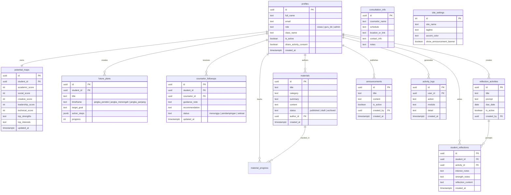

# Implementation Plan: Platform Web BK & Pengembangan Potensi Siswa (React + Supabase)

Dokumen ini merupakan rencana implementasi final menggunakan **Opsi 1: React (Vite + TypeScript + Tailwind CSS) + Supabase (PostgreSQL, Auth, & Row Level Security)** yang dapat di-hosting secara **gratis** di **Vercel** dan **Supabase**.

---

## 1. Kesesuaian Proposal (6 Menu Wajib Halaman Utama)

Halaman utama produk (*Landing / Portal Utama*) dan navigasi inti siswa akan selalu memuat 6 menu wajib sesuai proposal:
1. **Beranda** — Ringkasan platform, pengumuman aktif dari Admin, akses cepat, dan tombol masuk ke 3 Dashboard.
2. **Kenali Diriku** — Katalog materi pengenalan diri (kepribadian, gaya belajar, manajemen emosi, eksplorasi bakat).
3. **Peta Potensi** — Pemetaan minat & kekuatan diri dengan visualisasi interaktif (*Radar Chart* & ringkasan kekuatan).
4. **Rencana Masa Depan** — Penyusunan target studi/karier (jangka pendek, menengah, panjang) beserta *checklist* langkah aksi.
5. **Refleksi dan Tindak Lanjut** — Pengisian refleksi minat/kekuatan diri, kegiatan refleksi dari Guru BK, serta catatan arahan & tindak lanjut.
6. **Privasi dan Bantuan** — Kontrol persetujuan privasi siswa (*opt-in* berbagi ringkasan ke Guru BK), panduan penggunaan, dan info konsultasi BK.

---

## 2. Arsitektur & Tech Stack (Gratis di Hosting)

- **Lokasi Proyek**: `C:\Users\raphking\Desktop\Reactjs\belajar-web`
- **Frontend**: React 18 + Vite + TypeScript + Tailwind CSS + Lucide React + Recharts.
- **Backend & Database**: **Supabase** (`@supabase/supabase-js`)
  - **PostgreSQL Database**: Menyimpan seluruh data user, materi, refleksi, peta potensi, rencana masa depan, arahan BK, pengumuman, pengaturan tampilan, dan log sistem.
  - **Supabase Auth**: Login & registrasi akun berbasis email/password untuk Siswa, Guru BK, dan Admin.
  - **Row Level Security (RLS)**: Menjaga privasi langsung di level database — Guru BK hanya dapat membaca detail refleksi/peta potensi/rencana dari siswa yang kolom `share_activity_consent = true`.
- **Dual-Mode (Supabase + Mode Demo Lokal Otomatis)**:
  - Saat `.env` (`VITE_SUPABASE_URL` & `VITE_SUPABASE_ANON_KEY`) sudah diisi → aplikasi terhubung penuh ke database **Supabase**.
  - Saat `.env` belum diisi (misalnya saat pengujian awal di komputer lokal) → aplikasi otomatis berjalan dalam **Mode Demo Lokal** (`localStorage` + *seed data* realistis + *Quick Role Switcher*) sehingga Anda bisa langsung menguji semua fitur 3 dashboard sebelum membuat akun Supabase.
- **Target Hosting Gratis**:
  - Frontend: **Vercel** (atau Netlify) — Gratis.
  - Backend + Database: **Supabase Free Tier** — Gratis (500 MB PostgreSQL, 50.000 MAU Auth).

---

## 3. Skema Database PostgreSQL (Supabase)



### Kebijakan Keamanan & Privasi (Supabase RLS)
- **Siswa**: Hanya dapat membaca/mengubah data refleksi, peta potensi, dan rencana masa depan miliknya sendiri, serta mengatur `share_activity_consent`.
- **Guru BK**: Dapat mengelola `materials`, `reflection_activities`, `consultation_info`, dan `counselor_followups`. Hanya dapat membaca `student_reflections`, `potential_maps`, dan `future_plans` milik siswa yang `share_activity_consent = true`.
- **Admin**: Memiliki akses penuh untuk mengelola `profiles` (akun & hak akses), moderasi `materials`, `site_settings`, `announcements`, dan membaca `activity_logs`.

---

## 4. Rincian Fitur 3 Dashboard

### 1. Dashboard Siswa
- **Ringkasan Siswa**: Progres belajar, tugas refleksi aktif, pengumuman dari Admin, dan pintasan cepat.
- **Kenali Diriku**: Daftar materi pengenalan diri, pencarian/filter kategori, tampilan baca materi, dan tombol tandai selesai.
- **Refleksi Minat & Kekuatan Diri**: Form refleksi pribadi + daftar kegiatan refleksi dari Guru BK, beserta riwayat isian.
- **Peta Potensi**: Slider/input 5 dimensi potensi (Akademik, Sosial, Kreatif, Kepemimpinan, Teknis) + Radar Chart interaktif + catatan minat & kekuatan utama.
- **Rencana Masa Depan**: CRUD rencana (jangka pendek/menengah/panjang) lengkap dengan *checklist* langkah aksi dan *progress bar* otomatis.
- **Privasi, Tindak Lanjut & Bantuan BK**:
  - Toggle persetujuan privasi (*Izinkan Guru BK melihat ringkasan aktivitas saya*).
  - Daftar arahan & tindak lanjut dari Guru BK.
  - Panduan penggunaan platform + kartu informasi jadwal & kontak konsultasi BK.

### 2. Dashboard Guru BK
- **Ringkasan & Analitik**: Statistik total siswa, jumlah siswa yang menyetujui berbagi aktivitas, jumlah materi aktif, dan grafik distribusi.
- **Kelola Materi BK**: CRUD materi pengenalan diri (status Draft / Published).
- **Kegiatan Refleksi Siswa**: CRUD kegiatan/prompt refleksi beserta tenggat waktu yang langsung tampil di Dashboard Siswa.
- **Ringkasan Aktivitas Siswa (Berbasis Persetujuan)**: Daftar siswa dengan indikator status privasi; detail refleksi, peta potensi, dan rencana hanya terbuka jika siswa menyetujui.
- **Arahan & Tindak Lanjut**: Formulir pemberian arahan, rekomendasi, dan pembaruan status pendampingan siswa.
- **Informasi Konsultasi BK**: Mengatur jadwal layanan, ruang/tautan konsultasi daring, dan kontak BK.

### 3. Dashboard Admin
- **Pemantauan Fungsi Website**: Status modul sistem, grafik aktivitas, metrik pengguna per peran, dan tabel *Activity Log*.
- **Kelola Akun & Hak Akses**: Tambah/edit akun, ubah peran (`siswa` / `guru_bk` / `admin`), dan aktifkan/nonaktifkan akses akun.
- **Kelola Data Materi**: Moderasi seluruh materi (publikasi, arsipkan, edit, hapus).
- **Pengaturan Tampilan Website**: Ubah nama website, tagline, warna tema aksen (Biru, Indigo, Emerald, Teal), dan toggle banner pengumuman secara *live*.
- **Informasi & Pengumuman**: CRUD pengumuman global yang tampil di Beranda dan semua dashboard.

---

## 5. Struktur Direktori Proyek

```text
bk-potensi-web/
├── .env.example                     # Template VITE_SUPABASE_URL & VITE_SUPABASE_ANON_KEY
├── README.md                        # Panduan setup lokal + deploy gratis Supabase & Vercel
├── supabase/
│   ├── schema.sql                   # Skrip pembuatan seluruh tabel + kebijakan RLS
│   └── seed.sql                     # Data awal (materi, pengumuman, info konsultasi, pengaturan)
├── src/
│   ├── lib/
│   │   └── supabase.ts              # Inisialisasi client Supabase & deteksi mode online/lokal
│   ├── types/
│   │   └── index.ts                 # Definisi tipe TypeScript
│   ├── data/
│   │   └── seedData.ts              # Data awal untuk Mode Demo Lokal
│   ├── context/
│   │   └── AppContext.tsx           # Abstraksi data (otomatis pakai Supabase jika .env ada, atau localStorage)
│   ├── components/
│   │   ├── layout/
│   │   │   ├── PublicNavbar.tsx     # 6 menu wajib proposal + tombol Login/Dashboard
│   │   │   └── DashboardLayout.tsx  # Layout sidebar + topbar + indikator mode DB + Role Switcher
│   │   └── common/
│   │       └── StatCard.tsx
│   └── pages/
│       ├── HomePortal.tsx           # Halaman utama produk (6 bagian sesuai proposal)
│       ├── AuthPage.tsx             # Halaman Login / Daftar (Supabase Auth & Quick Demo Login)
│       ├── student/                 # 6 halaman/tab Dashboard Siswa
│       ├── counselor/               # 6 halaman/tab Dashboard Guru BK
│       └── admin/                   # 6 halaman/tab Dashboard Admin
```

---

## 6. Rencana Verifikasi

1. **Type Check & Production Build**: Menjalankan `npm run build` tanpa error TypeScript maupun Vite.
2. **Validasi SQL Schema**: Memastikan seluruh tabel, foreign key, dan kebijakan RLS pada `supabase/schema.sql` valid untuk PostgreSQL Supabase.
3. **Verifikasi Browser (End-to-End)**:
   - Memeriksa 6 menu wajib proposal di Halaman Utama.
   - Menguji interaksi lintas-dashboard (persetujuan privasi Siswa ↔ Guru BK, kegiatan refleksi & arahan Guru BK ↔ Siswa, pengumuman & tema Admin ↔ seluruh tampilan).
4. **Panduan Deployment**: Menyertakan langkah jelas di `README.md` untuk menyalin `supabase/schema.sql` ke SQL Editor Supabase dan menghubungkannya ke Vercel secara gratis.
